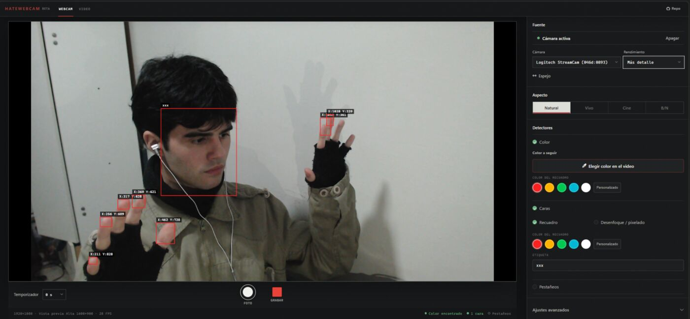

# hatewebcam

Webcam y editor de video **local** en el navegador: filtros en vivo, detectores visuales, captura y exportación sin cuentas ni subidas.

**Usar en línea:** [hatemecha.github.io/hatewebcam-web](https://hatemecha.github.io/hatewebcam-web/) · versión **0.1.0** (beta; la UI puede cambiar)



## Qué hace

- Vista previa con filtros y ajuste fino.
- Foto (JPEG) y video (MP4/WebM según el navegador), con vista previa antes de descargar.
- Detectores: color, caras (Face Mesh) y pestañeos.
- Perfiles guardados en `localStorage`.
- Interfaz responsive (HUD móvil) en **español e inglés**.
- Editor de video con timeline, efectos por intervalos y **Visual FX** (GPU local).
- Todo el runtime está en `vendor/` (sin CDN).

## Usar

1. Abrí la [app en vivo](https://hatemecha.github.io/hatewebcam-web/) o servila en `localhost` / `https` (no `file://`).
2. Permití acceso a la cámara (modo Webcam) o importá un video (pestaña Video).
3. Ajustá, capturá o editá; descargá el resultado al disco.

Guías más largas: [Visual FX](docs/visual-fx.md) · [CHANGELOG](CHANGELOG.md)

## Desarrollar

Requisitos: Node `^20.19.0` o `>=22.12.0`, cámara opcional para pruebas manuales.

```bash
npm ci
npm run dev      # http://localhost:5173
npm test
npm run lint
npm run test:browser
npm run build
```

CI en `main`: formato, lint, tests, Playwright y build; si pasa, despliega GitHub Pages desde el mismo artefacto.

| Doc                                | Contenido             |
| ---------------------------------- | --------------------- |
| [CONTRIBUTING.md](CONTRIBUTING.md) | Issues y PRs          |
| [DESIGN.md](DESIGN.md)             | Sistema visual        |
| [PRODUCT.md](PRODUCT.md)           | Producto y límites    |
| [SECURITY.md](SECURITY.md)         | Reportes de seguridad |

Licencia [MIT](LICENSE) · terceros en [THIRD_PARTY_NOTICES.md](THIRD_PARTY_NOTICES.md) · Alex Romero (`hatemecha`)

---

## English

**hatewebcam** is a privacy-first browser app for live webcam filters, visual detectors, photo/video capture, and a local timeline editor with GPU Visual FX. No backend, no accounts, no uploads at runtime.

**Try it:** [hatemecha.github.io/hatewebcam-web](https://hatemecha.github.io/hatewebcam-web/)

**Develop:** `npm ci && npm run dev` → open `http://localhost:5173`. Run `npm test`, `npm run lint`, and `npm run test:browser` before pushing. See [CONTRIBUTING.md](CONTRIBUTING.md) and [docs/visual-fx.md](docs/visual-fx.md).

Processing stays on-device; formats depend on your browser’s `MediaRecorder` / WebCodecs support.
